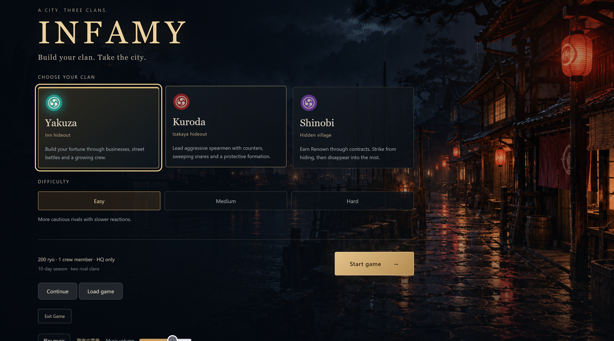
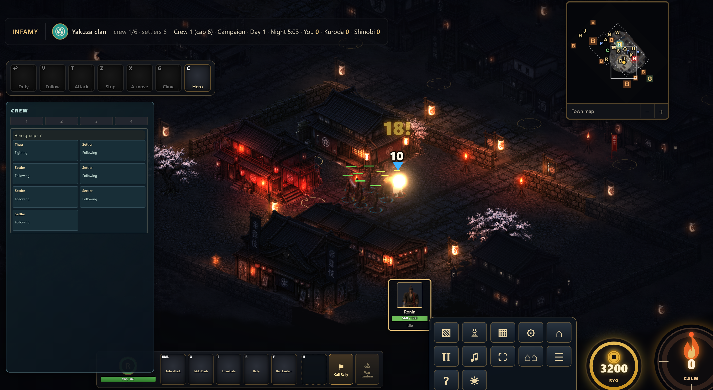
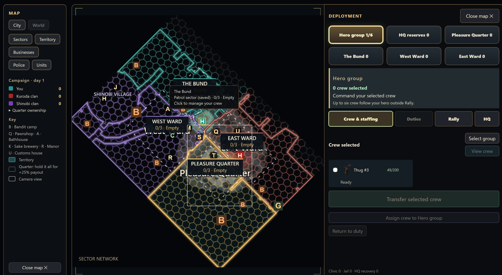
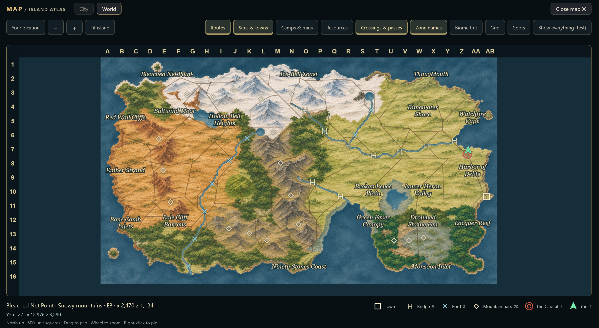
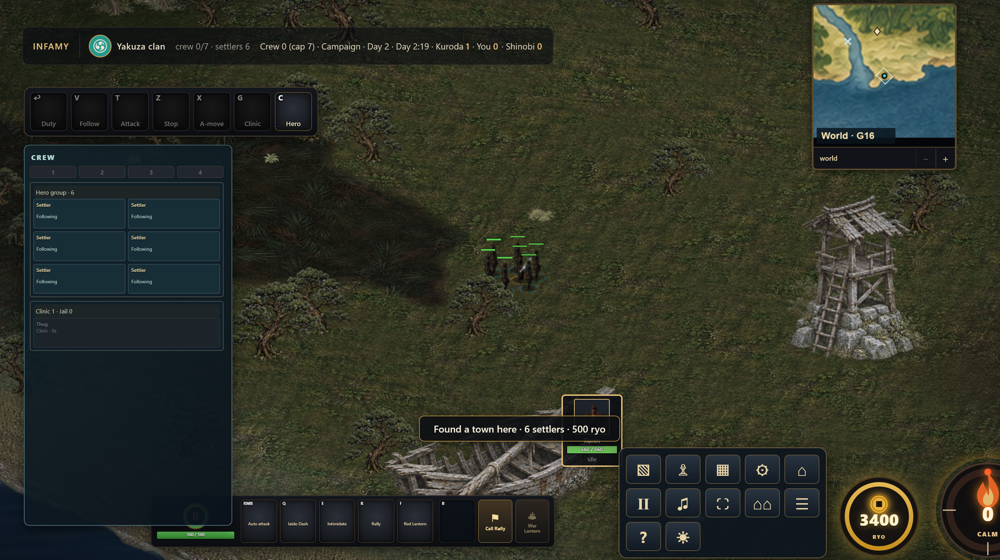
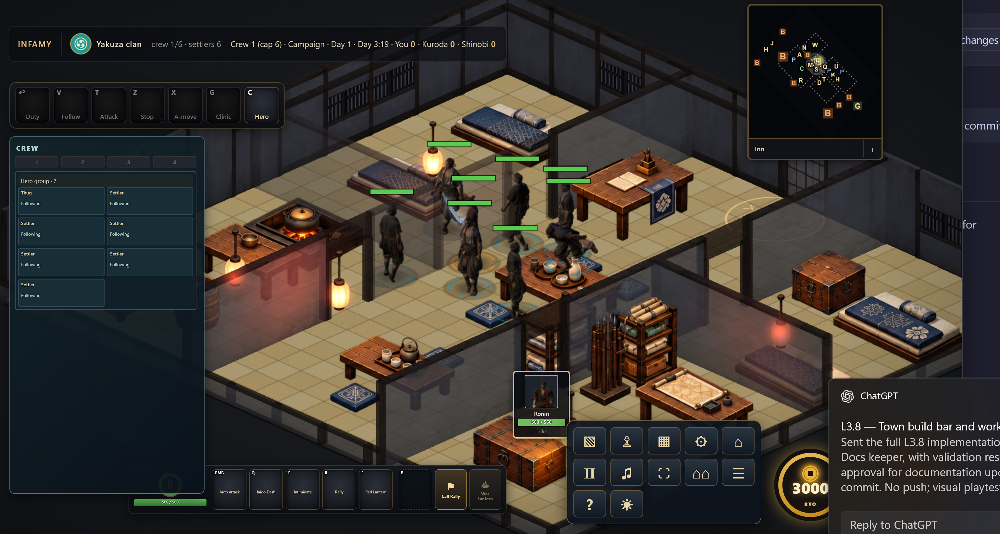

# Infamy

Infamy is an in-development browser strategy game set in 1870s Japan. Lead a clan through a contested port town: recruit and command a crew, build a criminal operation, fight rivals and deal with the police. Beyond the city lies an island frontier to explore and settle.



*Choose a clan and difficulty at the start screen.*

**New here?** Start with [START_HERE.md](START_HERE.md) for project rules and links, and see [game controls](docs/controls.md) for the current controls.

## Play locally

1. Install [Node.js](https://nodejs.org/) and use an internet connection for the browser's three.js modules.
2. On Windows, double-click `start_game.bat`. It starts the local server and opens the game in your browser. Leave its window open while playing.
3. Choose Yakuza, Kuroda or Shinobi and a difficulty, then start. Use Continue or Load game on the start screen to return to a save.

The server can also be started from the repository root with `node game/server.mjs --open`; it normally opens `http://localhost:8137/game/` and chooses a nearby port if needed. See [test setups](docs/test_params.md) for development playtests and [controls](docs/controls.md) for save, movement and map commands.

## Current state

**Playable development build, updated 2026-11-04.** The city game is playable against bots; the frontier campaign is an active build, with some features available through development saves and playtest setups. The normal start screen currently starts the city game.

- **City and clans:** Three playable clans, rival bots, crew recruitment and orders, businesses, territory, combat and night raids. Shinobi also have stealth and contracts; police, civilians, clinics and interiors are present.
- **Island frontier:** Travel out of the capital in a campaign, explore a walkable island, scout sites and encounter bandit camps. The illustrated World atlas has named regions, coordinates, biome hover, discovered locations and switchable layers.
- **Expeditions and towns:** The founding slice supports settlers, founding on suitable land and persistent town records. The frontier economy and town panels provide an early foundation for production and management; some town art is still a stand-in.
- **Gathering and building:** Town grids, zones, resource spots, workers, a build bar and worker orders are implemented. The full town-building loop and recent town and worker visuals await playtesting.
- **Saves:** Local save/load and dawn autosaves are available. Multiplayer is a design goal; the current build runs single-player with bots.

The current checkpoint and outstanding playtests live in the [frontier build plan](docs/frontier_build_steps.md). The [roadmap](docs/roadmap.md) covers the wider project.

## Screenshots

| City combat | City map and deployment |
|---|---|
|  |  |
| **Island atlas** | **Founding on the frontier** |
|  |  |

**Inside the inn hideout**



These screenshots are from a development build; the atlas image includes a test-only control.

## Repo layout

| Path | What it is |
|---|---|
| `docs/` | Design and tech docs (listed in [START_HERE.md](START_HERE.md)) |
| `game/` | The game: sim, render, data (see `docs/architecture.md`) |
| `look_tests/` | Standalone HTML experiments. Open any file in a browser. |
| `screenshots/` | Development screenshots used in this README |
| `assets/` | Concepts, environment sheets, models, animations, sprites and prompt files (see `docs/art_direction.md`) |
| `tools/export_sprites.mjs` | Batch-exports each model with its animation set to `assets/sprites` |

## Look tests

- `look_tests/lantern_street.html`: rainy lantern-lit street with wet reflections, mist, a see-through cutaway and a Realistic to Anime style slider.
- `look_tests/voxel_character.html`: one ronin built from about 108,000 one-centimetre cubes, with idle and walk animations. Kept as an example only; the art pipeline uses sprites instead.

- `look_tests/sprite_render_test.html`: drop in a rigged model and Mixamo animations to preview all 8 isometric directions and export a transparent spritesheet.

All of them load three.js from a CDN, so they need an internet connection.

## Exporting sprites

This is THE process for new characters and items and for updates to existing ones (Tim, 2026-11-01).

One-time setup in the `infamy_game` root (already done on Tim's PC): `npm install sharp playwright`.

```
node tools/export_sprites.mjs . <model> --pack
```

- `--pack` repacks just the exported models into the live catalog afterwards (runs `tools/repack_model.mjs`).
- `--portrait` also renders the 512 px character-page portrait (idle, front row) to `assets/sprites/portraits/`; with `--pack` it goes into `assets/sprites_packed/portraits/`.
- `--margin=N` sets the gutter between packed frames (passed through to the repack).
- Overwritten sheets are archived automatically to `assets/sprites_archive/<date>_<model>/` (once per day per file).

Repack without exporting: `node tools/repack_model.mjs <model> [more models] [--margin=4]`, `--all` for every model (slow), `--dry` to report sizes only, `--portrait` for portraits.

Add `--glow-only` to write just the weapon glow sheets (`<sheet>_glow.png`) and keep the colour sheets.

This renders each model in `assets/models` with its own animation set from `assets/animations` to `assets/sprites/<model>_<animation>.png`, overwriting earlier exports. Add model names after `.` to export only those (`node tools/export_sprites.mjs . thug brute`). Animation sets go by subfolder of `assets/animations`, keeping Mixamo's own filenames: `brawler/` (thug, brute), `gunner/` (mercenary), `ninja/` (ninja leader and ninja grunt), `archer/` (archer), `civilian/` (geisha and other townsfolk, the default). Files directly in `assets/animations` are the ronin's combat set. `Mutant ...` files in `brawler/` are brute-only and replace the plain clip of the same name (`Mutant Walking` replaces `Walking`). A filename prefix such as `brawler_walk.fbx` also works. The mapping is at the top of the script.

Without `--pack` an export is not added to the packed runtime catalog. A full sprite audit is only needed for catalog-wide policy changes; see [the packing gates](docs/art_direction.md#characters-proven-end-to-end-with-the-ronin-2026-10-14).

Held items (weapons, props) go in `assets/models/items/` as `.glb` (or `.fbx`), and `ITEMS` at the top of the script says who holds what (for example the mercenary holds `rifle.glb` in both hands). Sizes per character are in `SCALE` (the brute is 1.12x). The sprite test page has matching controls for trying an item and its grip by hand.

## Tech

The browser client uses JavaScript ES modules and three.js, with isometric character sprites rendered from 3D models. The simulation owns game rules and state; the client sends commands and renders the results. A local Node server serves the game and saves. The architecture is designed for multiplayer later; a networked multiplayer release is not built yet. See [architecture](docs/architecture.md) and [art direction](docs/art_direction.md).

## Name

**Infamy** (decided 2026-10-14; was "Prestige and Infamy").
