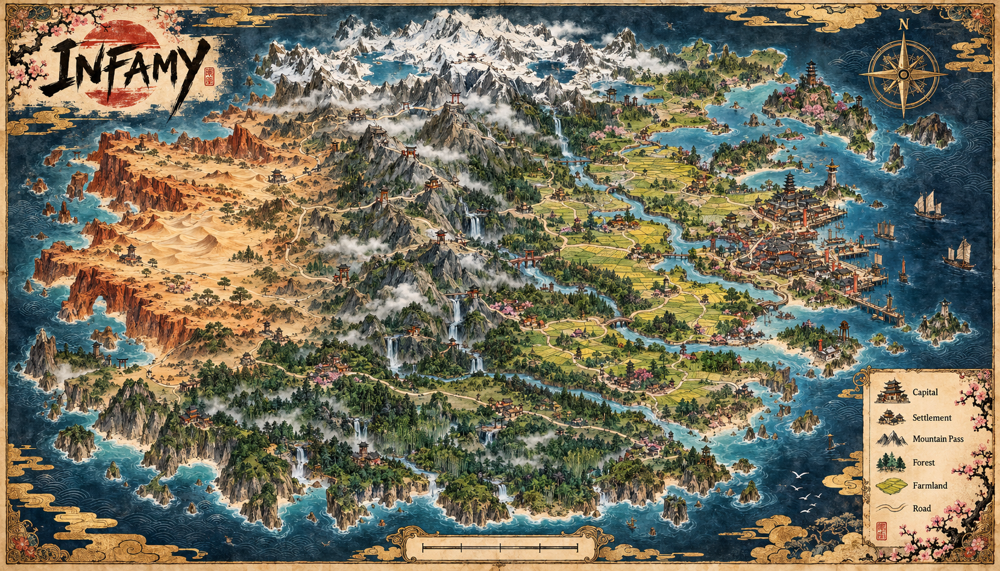

# Frontier campaign plan

**Design record (2026-10-31): documentation approved; implementation is not approved or built.**

This page owns the proposed capital, frontier, settlement, supply and larger RTS campaign.
It describes the intended game after the current city match, not current gameplay.
Current city rules and build status remain in the existing owner docs.

## Classic snapshot before frontier build (Tim, 2026-10-31)

Tim will manually copy the existing city game outside this project folder as a
preserved Classic snapshot before frontier implementation. Development then
continues in this current project. No copy or move is requested now.

## How to read decisions

- **Agreed direction** means a design constraint Tim has settled for planning.
- **Proposed starting point** means a small first implementation to evaluate, not an approved rule or number.
- **Open choice** needs a later design decision and, where relevant, a balance playtest.
- **Deferred** stays outside the first frontier build.
- All phases below are proposed sequencing. They authorize no code, asset or data changes.

## Campaign shape — agreed direction

- The current city becomes the first capital on a larger isometric island or continent.
- Regions contain territory, limited buildable settlement sites, resources, outposts and roads.
- The hero explores the map and can lead a small crew or join larger frontier battles.
- Expansion comes from founding or capturing settlements and connecting them.
- A region's main settlement controls the region in the initial design direction.
- Remaining enemy outposts become contested after that capture; they do not instantly flip into free assets.
- Rationale: those outposts remain meaningful follow-up objectives and give defenders time to respond.
- A disconnected capture remains a real possession with a logistics problem, not a magic connection.
- The current revised sketch has **24 full land regions plus 12 coastal partial regions**. Region count and dimensions remain provisional map targets, not capacity guarantees.
- Start with curated capital and region structure so travel, defenses and resources can be balanced.
- Add procedural variation later if the curated version is good; make it optional.
- More capitals are a later possibility, not a first-slice requirement. Railways: see [Railways](#railways-plan-2026-11-07-not-built).

## Railways (plan 2026-11-07, not built)

Full plan: `/mnt/project-files/steam_trains/plan.md`. Built (2026-11-07): steps 1-4: route finder (`sim/frontier/rail_route.js`), 10-minute track laying and trains (`sim/frontier/rail.js`, `data/railways.json`), ride / Skip; track art `art/ground/rail_track.png`, `rail_bridge.png` (`render/rail_track.js`); map lines (`src/rail_map.js`). Tests: `tools/test_rail_route.mjs`, `tools/test_rail_link.mjs`. Dev save `rail_test_kuroda` (`tools/make_dev_save.mjs`). Track routes round town buildings (`sim/frontier/rail_town.js`); railway cells refuse buildings and zones (roads may cross), and governor auto-placement skips them. Rail gang: hammerSeconds 2, speed 4.5 (`railways.json`). Train speed: 20 when a hero is near or riding (`train.viewSpeed`, within `train.viewRange`), 36 otherwise. Setting: 1870s Meiji Japan; British-built locomotives with Japanese crews.

- Look and sound (built 2026-11-07): a train is engine + tender + `train.consist` (`railways.json`, default carriage, carriage, goods, goods, guard), drawn from the `train_*` sprites; 8 seats per carriage. Track and bridge strips draw with hard edges (no edge fade); corners stay rounded. Trains whistle on departure, run on a steam loop (nearest 3 trains, pitch by speed), play the approach about 12 s before a station and brake 2.5 s before stopping; heard to 3.5x the normal sound range, volume by distance.
- Train cars (2026-11-07): each sprite car is placed by two bogie points 1.0 in from its ends and faces along the chord between them; the nearest sheet row is used and the picture is turned in the screen plane to cover the rest.
- Train at a station: a standing train is drawn inside the station; cars within 8 track units of the station end are hidden. The engine stands 6.5 units in, facing out, with a flashing badge and a wait bar above it (red in its last quarter).
- Steam (`render/train_fx.js`): from the chimney; slow wisps while standing, puffs while running (more with speed); on the whistle a thin upward plume for 1.6 s.
- Capital station: at (92,-6), north of the east trail by the island gate (was (86,16)); about 21 units from the East trail camp.
- Capital station (2026-11-08): the coach_house is mirrored so its open front faces east; a ticket hall (railway_station art) stands just west of it, and Space at its window opens the station menu. Line 1 runs through the shed; lines 2-4 idle on sidings along its north side.
- Boarding is by All aboard (see controls.md, Space at a station); followRange and heroGroupRange are no longer used. The camera follows the train while you ride; a pan holds until Home. Horses and vehicles stay at the station you leave from.
- Town station: one 3x2 placement (ticket hall, engine shed, railway slot). R turns it; an arrow on the ghost shows where the track leaves. Erasing a station with lines needs a second erase, which tears the lines up.
- The rail gang keeps up with the railhead.
- Track routing (2026-11-08): keeps 11 units (one town cell) from mountains, cliffs and water (`railways.json` route.clearance); corners round to arcs (route.minRadius 24). In towns it leaves a 3x2 station straight out of its mouth, then bends at most 45° with a straight cell between bends. A station whose mouth can't curve out is refused ("turn it (R) or clear a way").
- World map: Railways layer switch (on by default); the key shows open lines and lines being laid (dashed; the dot is the rail gang).
- Purpose: rail is the main trade channel between your towns and the only fast way between them. No timetables, driving, cargo picking or track placing. Instant rickshaw station travel is removed when trains arrive; rickshaws stay as driveable 2-seaters.
- Unlock around town tier 2-3. First line: capital to your first town, then town by town. Lines link only your own towns and the capital.
- Building a link: the governor proposes lines (card with route, time and cost), or order one from the station card (Link to...). The game picks the route over world terrain cost (`world.json` roadCost). A link takes 10 minutes at any length, paid in timber and goods as it goes; it waits when stock runs out. An optional 2nd gang works from the far end. A rival attack knocks the gang out (~30 s) and sets the link back ~1 minute, at most once per link per day; wild bandits leave gangs alone.
- Station: a placed building beside the omnibus station, tier-gated; builds locomotives and carriages. The capital gets a station in the endgame.
- Trains run automatically. Shipments go by rail only (no road-cart fallback; see [Rail shipments rules](#rail-shipments-rules-rail-step-5)). Travel: board at a station with your crew; ride along or Skip after 5 s. A closed line makes the train detour, or stop at the last station before the break.
- Cargo: food, timber, stone, goods, ryo. Each town keeps a reserve; the governor ships surplus to short linked towns and spare goods to the capital for ryo. Buying supplies: ryo on a town's card buys what it is short of, shipped by train (unlinked towns cannot buy); buying costs more than selling pays.
- Outlaw play: a blasting charge closes a line for 1 day (same line not again for 4 days). Robbery: plant a charge on the freight wagon and hold ~30 s; win = up to 25% of the cargo; cap 1 per line per 2 days. A unit on the track when a train passes is killed. No heat on the frontier.
- Defence: fighting happens on the ground beside a stopped train. Troops garrisoned in carriages (e.g. 4 per carriage) pile out; optional paid former-samurai guards. Alerts open the World map at the spot.
- War: an attacker's siege camp keeps a blasted line closed while it stands; a town at the end of a closed line goes short and is easier to capture.
- Build steps: 1 track data and route finder; 2 link command and 10-min laying; 3 station building and trains; 4 ride / Skip, rickshaw travel removed; 5 governor shipments and line proposals; 6 blasting, robbery, garrison, guards, alerts, bots; 7 painted art, train sprites, railway worker.

### Rail shipments rules (rail step 5)

- The capital holds no stock. Port wholesale houses (tonya) buy and sell anything for ryo; buying costs more than selling pays.
- Keep amount per resource per town (default: upkeep plus the next build; editable). A town never gives below keep plus reserved.
- Order fields: from, to, resource, amount, ryo, auto/manual, state, sources, losses. The player names only the need; the source is the nearest surplus town, then the capital. Optional source pin and urgent flag. Accepted amounts are reserved at the source. Orders stay open with a progress bar.
- The rail clerk runs at each governor review: auto orders, capital auto-buy (on, with a small budget per town), selling spare goods. Manual orders go first. Minimum order size and a cap on open auto orders (data).
- Trains carry tagged consignments; cargo transfers between lines at stations. Each trip loads one wagon-load per waiting order, then fills spare space. A blasted line holds cargo; nothing is lost.
- Robbery (existing caps): the loss is shared equally by every order aboard, with a ledger entry, alert and ping. The clerk re-sends the shortfall.
- UI: Rail ledger tab on the World map (selecting a shipment highlights its train). Town card Shipments tab: new order form (resource, amount, optional source pin, urgent), keep amounts with −/+, auto-buy budget, open incoming and outgoing orders with progress, sources and losses, "stock soon". Without a line the tab is greyed out with "Needs a rail line". Station arrival labels.
- Steps: S1 orders/keep/reserves · S2 consignments · S3 clerk · S4 town card and order form · S5 ledger tab · S6 robbery.
## World map scale and visual reference (revised sketch, 2026-11-01)

The current island draft is approximately **14,000 × 8,000 world units** (the first rough draft was about 14,000 × 7,000), with **24 full land regions plus 12 coastal partial regions**. The east-coast capital sits on the right-hand side of the water. Regions in the revised sketch are nominally about **1,750 × 1,400 units**. These are provisional measurements to validate in play, not streaming, population or capacity guarantees.

The winding main route is about **18,000 units**: roughly **50 minutes at the current base hero run speed of 6**, compared with a 1.7 walk speed. A developed settlement is about **400–700 units** across, or 1–2 minutes to cross; neighboring settlements have a rough 4–8 minute travel goal. Mounts and trains are later options to change actual travel time; instant travel is not the default.

Terrain transitions across coastal plains, fertile central/eastern farmland, central mountain passes, western rain-shadow desert, northern snow and southern rainforest/bamboo. Preserve alternate corridors so one chokepoint cannot seal the island. The atlas is an illustrative old-Japan fantasy-book direction: sumi-e/watercolor land and gold detail against an indigo sea. The concept image is a style reference, not a 1:1 map overlay.

**Island art checkpoint (2026-11-02):** W3.8's 25 requested source images are in `assets/environment/island/`; see the [prompt and asset list](../assets/image_prompts.md#island-art-w38-frontier). W3.9 imports and places cliff pieces deterministically from the approved blueprint-derived 50-unit mountain cells; blockers remain the terrain cells. The art review tour and its staged review props have been removed pending a later location pass. Since the first walkthrough, 21 follow-up art assets were generated and accepted: eight numeric lake-bank pieces, four opposite-bank rims, and nine high-ground B/C/D variants. They are saved beside the original world art. Their actual dimensions and orientation inventory are in the [walkthrough follow-up prompts](../assets/image_prompts.md#walkthrough-follow-up-art-prompts-2026-11-02); they still need mapping, resizing if integration requires it, and code integration. No new dry terrain/mountain layout has been approved; do not treat the old staged samples as mapped placements. The earlier `mountain_forest_broad.png` concept is obsolete and preserved.

**Island visual notes from first walkthrough (2026-11-02):**
- [x] Gate orientation selected; the road connects through the gate and blends into the grass in Tim’s screenshot.
- [x] City gate entry/return works well in Tim’s playtest; the hero can use the gate from the outside zone.
- [x] The black triangular area at the lower-right is the world edge, and the gate connection into the world works.
- [x] Forest cliff pieces approved; snow high-ground textures approved.
- [x] Dry individual art approved at the review scale, but the staged samples were scattered and in the wrong terrain. Map a connected dry range only after the dry terrain/blueprint layout is decided; include straight A/B pieces, mirrors, inner/outer corners, rims, tops, and travel stops.
- [x] Dry outcrop art approved at roughly one tree tall; moss and snow outcrops approved.
- [x] Pass-gate art approved; tour marker T27 was in a field rather than a real pass. Fit and scale it at an actual mountain pass; avoid orphaned props.
- [x] Outer forest/snow corners approved. Forest/snow inner corners protrude, but are acceptable for now; later calibrate them with a shared measured projection anchor/shear and blend edge snow, rock, and vegetation.
- [x] Dry rims approved as art, but the staged samples were disconnected and outside intended terrain. Four forest/snow opposite-bank rims were generated and accepted; mirrored companions are separately generated reverse orientations, not pixel flips.
- [x] Ford art approved; later shrink it by 1–2 tiles to fit thin river crossings.
- [x] Dry high-ground texture approved, but shrink it to one tile as part of a larger mosaic. Forest/snow high-ground textures approved; B/C/D variants for all three biomes have now been generated and accepted.
- [x] Ground textures show long repeated lines/obvious tiling; blend the existing 16 forest texture types and the new B/C/D high-ground variants into a natural mosaic. The island still uses mostly city ground textures, and `islandBiome` currently treats regions other than snow/dry as forest for mountain art. (done in W3.10, 2026-11-03)
- [x] Baseline island ground paint and region palette landed in W3.10 (2026-11-03). Snow-code (`n`) cells still use placeholder sand/gravel weights; `top_snow` only covers mountain (`m`) cells.
- [ ] Integrate the four generated snow-lowland textures (`ground_snow.png`, `ground_snow_b.png`, `ground_snow_thaw.png`, `ground_snow_thaw_b.png`) across snowy cells with a blended thaw band. Coordinator verified they are 1254 × 1254 and fully opaque (alpha 255), despite the 1024 × 1024 prompt target. Large-area seamless continuity is not verified; mild directional grain or patch alignment may show. Review dry and other regional terrain coverage in this pass.
- [x] Eight narrow lake-bank segments were generated and accepted with numeric filenames to avoid compass-name confusion. Order is N, NE, E, SE, S, SW, W, NW. The source prompts requested 1024 × 1024; saved files are 1254 × 1254. `lake_edge_1.png` is the approved north v3. The original lake image and specified drafts are retained; one obsolete draft was moved to `to_delete/` at Tim’s request.
- [x] Replace the old oversized repeated painted-water lake-edge decals with the accepted narrow bank segments; let the renderer supply water and align bank art/collision to the mapped shore. (done in W3.10, 2026-11-03)
- [x] Import and place the four accepted opposite-bank rim orientations on mapped forest/snow ranges; verify high-ground sides face inward. (done in W3.10, 2026-11-03)
- [x] Resize the accepted ford art by 1–2 tiles and fit it at actual thin river crossings. Fit pass gates to valid terrain crossings, not stale metadata locations. (done in W3.10, 2026-11-03)
- [ ] Map a connected dry range only after the blueprint/terrain decision adds mountain cells in a dry region; map all straight, mirrored, corner, rim, top, outcrop, and travel pieces together.
- [ ] Review mountain art contact, alignment, scale, and movement in the actual mapped terrain across biomes, corners, mirrored edges, passes, fords, lakes, and both gate directions.

The art plan’s inner-corner wording also matched straight south edges. Implementation and regression coverage use actual concave topology: south and east neighbors are mountain, while the southeast diagonal is free. The prompt list records generation; [art direction](art_direction.md#buildings-and-props-settled) links the reusable importer/fitting process.

References: **approved blueprint v2 (Tim, 2026-11-02): [overview](images/frontier/blueprint/v2_overview.png), [data](images/frontier/blueprint/world_blueprint_v2.json)**; superseded: [measured island sketch](images/frontier/measured-island.html), [island atlas](images/frontier/island-atlas.html); and concept image below.

## Shared systems before clan specialties — agreed direction

- Every clan can build a complete economy and fight a complete war.
- All clans can use trade, finance, intelligence, infiltration and defensive fortification.
- All clans can garrison, replace losses, reinforce, scout, move supplies and settle territory.
- No essential economy or war function is locked behind a clan choice.
- Rationale: choosing a clan should not remove a whole way to grow or fight.
- Existing units, hero abilities, tempo and presentation provide initial clan identity.
- Balance those shared mechanics before deciding whether any specialist building is useful.
- The earlier exclusive Yakuza tradehouse, Kuroda military HQ and Shinobi intelligence house idea was corrected; it is not the baseline.
- Specialist structures and unique frontier mechanics are deferred design options.
- Player and bot clans use the same underlying rules and costs.

## Capital and frontier relationship — agreed direction

- The capital keeps its primary role as a place for hero and small-crew combat.
- Its businesses, politics, police, contracts, stealth and local rivalries still matter.
- The frontier supplies goods, raw materials and manufactured products to city trade and influence.
- The capital supplies money, specialist recruits, imports and finance for frontier expansion.
- The exact market, currency conversion and bonus rules are open.
- Basic necessities can be sustained locally in a frontier settlement.
- A blockade first slows imports, advanced recruitment, major construction and resupply.
- It does not automatically stop existing defenses or collapse a settlement.
- Capital income and frontier production must have visible source and destination records.
- No extra productivity is granted merely because the player opens a view.

## Capital authority and campaign persistence

**Agreed direction (2026-10-31):**

- Start with multiple clans and a neutral civic authority in the capital.
- A city lieutenant handles the player's routine interests while the hero is away.
- Neutral civic AI continues city services and rules without pretending to be a player clan.
- Routine defense, recruitment, repair and income continue under budgets and standing orders.
- Offensive action uses an explicit stance, budget or authorization.
- A clan may lose its HQ or district foothold yet retain frontier territory and return later.
- A single HQ raid cannot automatically award the entire capital.
- Do not force the current three clans to remain the only campaign factions forever.

**Open choices:**

- Set conditions for expulsion, return, capital control, elimination and campaign victory.
- Decide how today's ten-cycle match and season score translate into a persistent campaign.
- Decide whether an absent player leaves standing policies, an AI lieutenant, or both in multiplayer.
- First build save/resume campaigns; true continuous MMO and offline-authority rules are deferred.

## Governors in every settlement — agreed direction

- Every settlement has a governor process that keeps operating while the hero is elsewhere.
- Player and bot governors use the same economy, construction and staffing rules.
- Governors track food, housing, workforce, resources, trade and local stockpiles.
- They allocate work, repair buildings, recruit approved replacements and maintain garrisons.
- They carry out approved projects within a budget and report why a project waits.
- Player priorities may be Grow, Produce, Trade or Fortify; these are illustrative labels.
- Military stance and spending limits are distinct from civilian production priorities.
- Major war spending, large upgrades and rail projects require approval or an explicit standing policy.
- Ordinary replacement and defense can proceed under the player's chosen budget.
- Reports should show shortages, current action, next action and expected consequence.
- Good defaults make routine towns manageable without daily micromanagement.
- Governors arrange ordinary supply and trade; the player sets priorities instead of individual deliveries.
- Visiting the settlement gives the player more direct actions and control, not a production aura.
- The earlier passive five-percent presence bonus is discarded.

## Settlement building — agreed direction

- Aim for a SimCity and Settlers hybrid with fewer dependencies than a full city simulator.
- The player strategically places walls, fortifications, major roads, resource works and military facilities.
- The player reserves residential, commercial, workshop/industrial and military zones.
- Discover prepared flat build sites from the world map. Settlers physically clear each full buildable cell through overgrown → clearing/stumps → grading → prepared stakes → developed; progress and resources are accounted for, and terrain is revealed rather than arbitrarily deformed in the initial version.
- Zoning autofills reusable building prefabs. Players place roads, walls and gates manually. Buildings use one fixed facing.
- Construction visuals progress from foundation to frame to finished isometric art. Damage progresses through damaged and ruined states with a stable repair anchor; share scaffolding and construction parts.
- Population buildings and jobs fill those zones when access, people and materials permit.
- Workers harvest and transport routine resources automatically within the settlement rules.
- Roads, gates and reserved paths must remain usable by people, armies and caravans.
- Placement cannot trap a generated neighborhood behind walls or impassable buildings.
- Growth may stall or decline gracefully; the report explains the limiting factor.
- One short shortage does not instantly downgrade a castle or delete established homes.
- A proposed starter set is food, timber, stone, manufactured goods and ryo.
- Well or river access is a proposed initial water model.
- Power, complex industry chains and exact consumption/production numbers are later decisions.

## Fortified settlement center — agreed direction

- The center is a stockade, then fortified compound/garrison, fort, and castle/citadel/keep.
- Those names are a progression outline; exact names and tiers are open.
- Upgrades reflect actual population, housing, roads, food, water, storage, economy and trade.
- The center also needs materials and a build project, not only a score threshold.
- An unlocked tier waits for player authorization or a standing governor construction policy.
- The fort supports further development, garrison capacity and defense.
- The center is the control/capture objective; its structure need not be destroyed.
- An unfinished upgrade remains an unfinished project through a visit or save/load.
- Capture does not silently award a completed tier or free missing materials.
- Exact thresholds, build times, upkeep and downgrade rules are open.

**Stockade (built 2026-11-06):** the town's shelter. Hero, crew and workers garrison inside (up to 40), cannot be attacked there and heal 3x faster. Building HP comes with F7 sieges. Details: `frontier_build_steps.md`, Stockade garrison.

## Frontier armies and the hero — agreed direction

- Frontier fights use larger RTS groups than capital street fights.
- The hero keeps current stats and the familiar hero group as the balancing baseline.
- Do not add an automatic frontier-only hero nerf.
- Balance frontier troops, fortifications and encounters around the existing hero baseline.
- The player can build, recruit, order, attack and defend after the hero is knocked out.
- Hero knockout is not an automatic battle loss or loss of all player control.
- A clinic or equivalent recovery facility is a proposed frontier recovery route.
- Recovery delay, cost and fallback when that facility is captured remain open.
- No instant resupply or free revival is inferred from current raid behavior.
- Do not import current hero-KO raid victory rules into frontier warfare.
- No battlefield body looting or inventory micromanagement for RTS armies.
- Hero equipment uses the same authoritative stat evaluation in the capital and frontier.
- Standard crew use unit-type equipment; they have no individual bags.
- Initial settlement zoom sits farther out for an RTS view. Reuse the existing packed character sprites at first; do not convert characters to 3D for this transition.

**Economy rule for warfare (2026-11-07):** materials build towns and zones; ryo builds armies (troops, barracks, cannons, siege camps). Ryo also buys supplies a town is short of, shipped by rail. Train income starts modest and is tuned once war is built.

## Hero equipment, exploration and rewards — agreed direction (2026-10-31)

- Start with three hero equipment slots: weapon, armor and one accessory.
- The capital now has 12 carried slots, a separate 12-slot HQ stash and three equipment slots (Tim, 2026-11-01). Frontier item implementation remains unbuilt; see the [capital inventory status](gameplay_and_design.md#inventory-and-loot-settled).
- The earlier [capital inventory and loot outline](gameplay_and_design.md#inventory-and-loot-settled) owns the existing stash, fence and carrying concept. This plan records how hero gear fits the campaign.
- Capital encounters and raid caches can award meaningful gear.
- Later frontier hero exploration can reveal ruins, caches, outposts and gear discoveries.
- The hero can explore and collect rewards on the frontier; the restriction is on RTS battlefield bag management, not on geography.
- Army battles do not require clicking bodies, sorting bags or assigning loot to individual soldiers.
- Existing crew looting behavior may retrieve eligible items to the shared stash under later item rules.
- A weapon or armor modifier works identically wherever the hero fights, through the existing authoritative stat evaluator.
- Initial equipment remains compatible with the hero's current kit; no new ability system is implied.
- Balance frontier troops around that hero baseline with equipped variants, without equipment that invalidates armies.
- Hero knockout does not destroy or drop equipped gear in the initial version.
- Use a few meaningful items and choices rather than frequent low-value drops.
- Primarily offer sidegrades; slight power increases and bounded item synergies are allowed.
- No mandatory rare best-in-slot item or runaway multiplicative stacking.
- Avoid initial durability, inventory Tetris and a huge random-affix pool.
- Capital craftsmen, merchants and fences using frontier materials are later possibilities, not built features.
- Rationale: gear makes capital combat and exploration interesting while larger battles still need armies.

### Bandit rewards and anti-farming boundary

- Bandits may occasionally yield useful modest hero gear, not only ryo.
- The best looted gear comes from meaningful accomplishments, such as a major encounter, raid cache or exploration discovery.
- Bandit gear is not required for progression, and repeat bandit grinding should not be the optimal or necessary path.
- Equivalent basic choices should be available by other routes.
- Do not create a guaranteed item per kill, a repeatable salvage-currency farm, kill-count grind or hidden pity chore.
- **Proposed mechanism, not approved:** tie some bandit gear to a first meaningful camp clear or exploration reward with a persistent claim record and seed; respawns and reloads would not reroll high-end items.
- That mechanism, drop frequency and any repeatable reward remain open design decisions.
- No promise is made that every repeatable drop has absolutely zero incentive.

## Army origin and capability — agreed direction

- An army has a persistent supply origin at a named settlement or network.
- Actual facilities, stockpiles and technology at that origin determine recruitment and equipment access.
- An army does not change its capabilities when crossing a nearest-settlement boundary.
- Capturing an advanced settlement does not auto-upgrade existing troops.
- Loss of a supply route does not instantly downgrade equipped units.
- Resupply, origin reassignment, field depots and transit behavior remain open choices.
- Unit, army and cargo identities survive movement, battle, save/load and view changes.

## Supply and roads — agreed first-scope direction (2026-10-31)

- Logistics supports settlement building and territorial RTS war; it is not a separate micromanagement game.
- Roads connect settlements, and governors automatically handle routine supplies and trade.
- The player sets settlement and military priorities, not individual cargo loads, caravan schedules or deliveries.
- Founding or capturing towns and outposts remains the main expansion objective.
- The first slice needs roads, automatic real shipments and interruption by enemy road occupation.
- Shipments have an actual source, finite cargo, travel progress and delivery receipt.
- Withdraw stock at departure and credit it only on delivery; a blocked shipment is never also delivered.
- Shipments and units keep stable IDs through travel, battle, save/load and view changes.
- Route blockage never teleports cargo or creates free goods.
- Show simple connection states: **Working**, **Threatened**, **Blocked**.
- Give an early warning with blocked location, affected activities and a response action.
- A governor may wait or choose a valid route when a road changes; exact routing policy remains open.
- Basic logistics and the same finite economy apply to all clans, including bots.
- Rationale: roads matter strategically without turning travel into routine chores.

### Traffic, intelligence and interception

- Use a strategic map to scout and move forces, with optional isometric zoom.
- Discovered geography remains known; enemy traffic requires fresh sight.
- Show a last observed position and direction after sight is lost, not a live omniscient route.
- Road interception is optional, not required to expand or operate a first-slice town.
- When hostile units physically contact a shipment or convoy, the world causes an encounter.
- The encounter continues under the same combat rules while offscreen; a button does not resolve it.
- Named custom routes, escort micro, detailed caravan hunting and scheduled theft are later options.
- Do not require repeated travel chores to keep ordinary settlements functioning.
- Captured cargo uses army or settlement logistics, never hero RTS body looting.
- Exact captured-cargo transport, loot share and escort rules remain open.

### Forgiving shortages and isolation — agreed behavior

- Established towns can provide local food and basic water and hold emergency reserves.
- Blocking the only road to a distant town or small army does not by itself doom the town.
- Imported materials, advanced recruitment, major construction and resupply slow first.
- Garrison troops fight, towers function and equipped units keep their gear while isolated.
- No automatic surrender or ownership loss follows from an isolation timer; an enemy must assault.
- A growing new site without established food cannot receive infinite free necessities.
- That site pauses growth and nonessential projects and draws on real reserves or local emergency production.
- Exact reserve quantities, production rates and supply penalties remain open.
- Initial version has no starvation-driven population loss.
- Do not infer blanket army upkeep attrition, loss of defensive ammunition or shutdown of essential services.
- A siege is dangerous because enemy forces attack and wear defenses down, not because a roadblock counts down to death.
- Rationale: shortage remains meaningful without a remote punishment or an automatic failure spiral.

## Garrison buildings — agreed direction

- Both attacker and defender may occupy suitable buildings.
- Start with a few clearly marked types: home, inn, warehouse and barracks candidates.
- The building shows faction, troop count, capacity and rest/fight state.
- Occupation is separate from civilian property ownership.
- Ranged troops may fire in any direction with line of sight and appropriate cover.
- Directional window-fire limits were rejected.
- Melee defenders protect entrances but gain no free projectile attack.
- Capacity and cover are real, and no ordinary house should automatically beat a tower.
- Secure, out-of-combat rest may recover troops; an occupied building under attack does not heal them.
- Infantry breach, demolition and siege tools provide counterplay to an occupied building.
- Occupants may evacuate before collapse; staying risks casualties.
- Exact collapse, spill and casualty formulas remain open.
- Civilians shelter automatically under the first version's simple rules.
- A siege need not clear every home before a stronghold can be captured.
- After combat, repair and security permit civilian reuse.
- A fully featured interior RTS is not required for the first frontier slice.

## Conquest sequence — agreed direction

- A stronghold attack has several stages so defenders have time to mobilize.
- First, secure or contest the outer approach and intercept local response.
- Next, breach or neutralize walls, gates, towers and other direct defenses.
- Then reduce, capture or isolate military and supply support.
- Finally, sustain an assault or control contest at the fortified center.
- A stealth unit or fast runner cannot skip directly to the center and end the battle.
- A healthy supporting city strengthens the center through finite real reserve troops, recruitment and resources.
- Capturing intact support is a viable alternative to razing civilian homes.
- Defender governors gather and reinforce from actual available units and stockpiles.
- Reinforcements obey travel time and route access; none appear from thin air.
- The battle must still finish if one hidden straggler cannot realistically contest control.
- Exact stage gates, control duration, minimum force and contested-region conditions are open.
- Existing raid timers and hero-KO win conditions are not copied by default.

## Destruction, occupation and aftermath

**Agreed direction:**

- Buildings have physical footprints and allow street combat around them.
- Forts, gates and towers can take direct structural damage.
- Military facilities can be disabled and later repaired or captured.
- Homes and workshops start with simple intact, damaged and ruined states.
- Capture, repair, occupation, garrison and restored stability produce a usable outpost.
- Its supply foothold only works when a real route exists.
- Repeated capture cannot mint free troops, stock or rebuild materials.
- A newly captured settlement may still be unsafe or isolated.

**Design options, not settled:**

- Sack and withdraw may trade immediate resources for control and stability.
- Raze may be a slow, interruptible operation rather than instant deletion.
- Decide ownership, damage, salvage and civilian consequences of each choice.
- Refugee flows are only a possible later feature and are deferred.

## Endgame and campaign length (2026-11-05)

Agreed with Tim on 2026-11-05 ("ok docs"). Nothing here is built yet.

**Length**
- A full campaign takes about 20 hours, over many sittings (save and return).
- Later, an optional "quick" setting of 8 to 10 hours, done by speeding up growth.

**Map and zones**
- 12 zones (the 12 coastal regions already in the map plan). The capital's zone is number one.
- Each zone has a rival town or fortified camp at its heart.
- Early zones next to yours are easy; later zones are harder; the capitals come last.

**Core loop:** grow your towns, build a crew, march on the next zone, win, repeat.

**Taking a zone**
- Beat the leader there: siege their town (F6/F7), or fight at the camp.
- You found only 2 or 3 towns yourself (permits earned through Influence). The rest come from conquest.
- Captured towns run themselves with the town governor; you steer only the ones you care about.

**Winning**
- Take 9 of the 11 rival zones, then the capitals open up. Capitals cannot be attacked before that.
- Final fights are the capitals. Win condition = capitals taken (exact rule still open).

**Damage and rebuilding**
- Buildings are standing or ruined. No half states.
- The attacker chooses how hard to hit: spare it, hit defences and hall only, or burn everything.
- Ruined buildings become ruin sites; rebuilding uses the normal build phases at a fraction of the cost.
- Houses lose their people, but the town keeps its tier.
- More burning means less income and a bigger rebuild bill. No loyalty meter.
- A taken town is fully yours. The old owner does not raid it back.

**Surrender**
- A defender can surrender: the town falls with little damage, the defender's hero and crew retreat to their nearest town.
- Defender saves their army; attacker gets a cheap win but must fight that army again.

**Travel**
1. Horse for the hero (about 3 times faster; roads faster still).
2. Fast travel between your own towns by rickshaw or boat, for a small fee. Shown as a short ride on the map (about 5 seconds), skippable with a key. The world keeps running during the ride.
3. Crew mounts later, with the warfare phase.
- Native tribe trade network: parked. Revisit only if travel still feels slow.

**Open questions**
- Exact win rule and zone difficulty curve.
- Where this fits in the build order (after the campaign loop checkpoints and warfare F6/F7).

## Goal card (2026-11-06)

Campaign only. `sim/campaign_goals.js` `goals.current(clan)` returns the current goal; `src/goal_card.js` draws it under the minimap.

- **Starter goals** come first, per clan: Yakuza: loot a body, gear up, 3 crew, first business, a shakedown, win a raid. Kuroda: the same with a sweep instead of the shakedown. Shinobi: loot, gear up, 3 ninja, a contract.
- **Founding chain:** buy a permit, hire settlers, leave the city, found a town.
- **After founding:** Lay out your town (road, housing and farm cells), Put workers to work (timber), Gather stone, Make goods (2 Work cells), Build a storehouse, Build a lumber camp and a quarry, Grow your people (20), Grow to Village (rows for 750 timber, stone and goods in stock, then Upgrade), Open a Market, then the next Influence tier. A Capital businesses row (hold 6 businesses) runs alongside. Each step flashes its button through the town panel (build bar tool, Workers button then the timber or stone spot, Upgrade). Numbers: `frontier.json` `goals`.
- **Permits after the first:** the Nth permit also needs one of your towns at tier N (2nd: Village, 3rd: Town); players only (`frontier.json` `founding.permit.townTier`).
- A clan holds at most 5 settlers at once (`units.json` `rules.settlers.max`).

## Alerts while on the island (2026-11-06)

While the hero is on the island the lieutenant runs the city. Only major capital news shows, prefixed "Capital:": a raid won against you, a quarter lost, your HQ raided, and one warning (once) when the clan falls below half the businesses it held on leaving. Other city pings are muted and the raid banner is hidden. Code: `src/news_callouts.js`, `src/main.js`.

## Knocked out on the island (2026-11-06)

The hero comes round after `heroRespawnSeconds` at his clan's nearest founded town hall with 30% health, or at the island side of the city gate if he has no town. Crew downed on the island come round at the nearest hall after 30 s with 30% health; Hero-group crew follow the hero again. City crew keep the clinic/HQ rules. Settings: `units.json` `rules.islandRespawn` `{ hpShare, crewSeconds }`. Code: `sim/island_respawn.js`. Test: `tools/test_island_respawn.mjs`.

## Lieutenant fairness and wage (2026-11-06)

`settings.json` `campaignCity.lieutenant`:
- `awayRaidShare` 0.5: rivals raid a clan whose boss is on the island on about half the nights.
- `stipend` 150: a city holding no business gets 150 ryo each new day while the boss is away.
- `captainWaitSeconds` 60, `captainFee` 100: a dead city captain is replaced after 60 s for 100 ryo.
- `banditJobMinutes` 6: time limit for a lieutenant's bandit job. A timed-out bandit job gives back that day's job once.
- `wageShare` 0.02: each day the lieutenant and captain are paid 2% of the clan's total ryo.

Code: `sim/lieutenant.js`, `sim/bot.js`. Test: `tools/test_lieutenant_hero.mjs`.

## Infirmary (2026-11-06)

Frontier building, 1 cell, 120 timber and 60 stone, 90 economy ticks; Camp 1, Village 1, Town 2 (`frontier.json` `buildings.infirmary`). Your units within 20 heal 3x faster. Anyone knocked out on the island comes round at the town's finished infirmary with full health; without one, at the town hall with 30% health. Code: `sim/frontier/infirmary.js`, `sim/island_respawn.js`. Test: `tools/test_island_respawn.mjs`.

## Lieutenant and governor goals (2026-11-06)

Goal chain (`sim/campaign_goals.js`): Buy a founding permit → Hire settlers → Meet your lieutenant → Give him his orders → Leave the city → Found your town → Lay out your town → Put workers to work → Gather stone → Make goods → Meet your governor → Give him his orders → Build a storehouse → Build a lumber camp and a quarry → Build an infirmary → Grow your people → Grow to Village → Open a Market. On the first return through the gate a Lieutenant's report callout flashes the While I'm away log.
- Lieutenant: stands by the island gate (sprite `lieutenant1`); Space opens a short dialogue (`src/lieutenant_talk.js`) with Show me (opens Deployment → While I'm away) and Later.
- Governor: stands by each town hall; Space opens his report, what each Focus does, and focus and initiative buttons. Placeholder look: `merchant` (`units.json` `rules.governorModel`, default merchant).
- Goal flashes on buttons use the stronger `.goal-flash` style (`index.html`).
- The stockade has a tooltip and no goal step.
- Bot clans' town governors always take initiative (`autoBuild` on). Code: `sim/frontier/governor.js`. Test: `tools/test_bot_founding.mjs`.
- New towns start with food 60, timber 50, stone 50, goods 50, ryo 20 (`frontier.json` `founding.startStock`).

Test: `tools/test_campaign_goals.mjs`.

## Bot frontier governor (2026-11-06)

`sim/frontier/governor.js`, `frontier.json` `governor`:
- Initiative spending cap: `s.budget.ryo`, or `initiativeBudget` 400 when the budget is 0.
- Camp rule: distance to the nearest drop-off.
- Initiative-only rules: storehouse when any stock reaches 80% of its cap; market at the goods keep level; infirmary at 20 residents; rule 9 stable at Village; rule 10 station at Village.
- `inputFullShare` 0.5. Goods target = max(`goodsProfitPerMin`, (next tier's goods cost − stock) / `upgradeGoalMinutes` 60).
- Bot towns queue one horse for their boss and build one rickshaw.

Soak: `node tools/bot_frontier_soak.mjs [gameMinutes] [stateFile] [seconds] [seed] [away]`. Test: `tools/test_frontier_governor.mjs`, `tools/test_bot_founding.mjs`.

## Omnibus (2026-11-06)

`sim/omnibus.js`, `units.json` `rules.omnibus`. The hero arrives on the island driving an omnibus (8 seats); a second follows; at most 2 per clan. Speed 3x; nobody inside fights. 800 HP: hits on riders land on the omnibus (stockade rule); wrecked, everyone piles out. Q or right-click deploys or boards (`#busicon` flashes on hover). Founding a town uses the omnibuses up. Bots use them too. Test: `tools/test_omnibus.mjs`.

## Stable and mounts (2026-11-06)

- Stable (`sim/frontier/stable.js`, `frontier.json` `buildings.stable`): horses only, raised by hand on a production bar: Calico or Black Beauty, food 80, goods 40, 60 s; max 3 per stable; Cancel refunds. Placed limit Camp 1, Village 1, Town 2.
- Mounts (`sim/mounts.js`, `units.json` `rules.mount`): on the island H rides, gets off or calls the horse (in the city H still hires). Speed 3.75x; no fighting mounted; thrown off below 1/3 HP and at the gate. Right-click your own horse to ride her. The first horse raised is the mount; the town panel picks another. The hero plays the `ride` clip.
- Test: `tools/test_stable_mount.mjs`.

## Omnibus station and rickshaws (2026-11-06)

- Station (`frontier.json` `buildings.station`, art `coach_house`): 1 per town, 200 timber and 80 stone. Production bar: rickshaw (60 timber, 20 goods, 45 s, max 3 parked) and omnibus (150 timber, 60 goods, 90 s); both come out empty and park.
- Rickshaw (`units.json` `rules.rickshaw`, model `rickshaw_horse`): 2 seats, 3.5x speed, 400 HP; right-click or Q.
- Rickshaw travel (`sim/station_travel.js`, `src/station_menu.js`): Space at a station, or at the rickshaw stand inside the city gate, lists your stations and the capital. Travel is instant; each waiting rickshaw carries 2 and parks at the destination. Refused within 10 s of a hit or with enemies within 12. Bots do not travel by rickshaw.

## Vehicle steering (2026-11-06)

`sim/vehicle_steer.js` `steer(e, want, { turnDegrees, turnSlow }, dt)` (the capital cart steering from `civilians.js` `drive()`): caps the turn rate, slows to 0.4 at turns of 90° or more, and sets `e.dir` from the heading so turns sweep through the 8 sprite rows. Used by the hero driving the omnibus or rickshaw or riding, the following omnibus, and called horses (dir only). `units.json` `turnDegrees`: omnibus 120, rickshaw 180, mount 240. Test: `tools/test_omnibus.mjs` (turn limit).

## Later phases: police on the frontier (planned 2026-11-08)

- Police following you onto the island (today they stop at the island gate).
- Frontier police: a police station per town; city heat and frontier heat are separate. Heat cools at the normal rate while you are in the other zone, but cannot be bribed off from there.

## Stable and town fixes (2026-11-08)

- Capital stable (the old rickshaw station): sells horses for 300 ryo, a rickshaw for 400 and an omnibus for 900 to permit holders. Purchases wait outside the island gate. It adds stable room: 2 horses, 1 rickshaw, 1 omnibus.
- Stable room is 8 horses at tier 1.
- Mount panel under the crew commands: portrait, status, Stay here, Send to stable.
- Select crew and right-click a horse: they ride it.
- The Governor tab holds all steering (the Steer tab is gone); the market keep level can be typed in. The Open a Market goal ends once the keep level is set.
- Camp ox carts leave the camp spaced apart.
- Crew panel: no flashing in the capital; paging no longer bounces.
- Frontier townsfolk use the capital's walker mix (`civilians.json` non-vehicle types, weighted by count) and stay within townsfolk.roam of the town hall: 45 / 80 / 130 units by tier.
- Frontier town workers' nameplates read "Worker".
- Market keep box has no browser number spinner.
- Governor tab: Focus is one row of buttons with a short caption; Taxes, Market keeps and Initiative show short captions with the full text in tooltips. Fortify = the governor builds a stockade first. Camps are worked only by trained workers.
- Build bar rows: Lay out (Eraser apart at the right, muted red), Zones, Camps, Buildings. Capped buildings show used/allowed; buildings the tier doesn't allow yet are greyed and dashed with the unlocking tier's name. Town panel tabs are underlined; the panel has a ✕ close button.
- Police never chase, attack or arrest units on the island (place 'world') at any heat tier; officers out there return to the city.
- Ride clips: every crew model has a ride clip (`coach_sitting`, art.json `ride` keys); the RIDE table in `tools/export_sprites.mjs` lists the riders.
- Worker loads: a worker carrying a harvest shows a small icon over him with the amount: logs (timber), a stone block (stone), a fish on a net (fish), a basket (forage), a rice sack (other food) (`src/cargo_icons.js`).
- All aboard zone: faint gold fill, soft dashed edge, dimmer countdown arc. Crew sitting in a rickshaw or omnibus inside the zone climb out and board; the vehicles stay.
- Train from the capital: only the boss's party boards at the city station (Hero group or Rally crew and settlers); sector crew and HQ reserves in the zone stay.
- Boss out on the island: Hero group crew left in the city become HQ reserves (they walk to the HQ; the lieutenant can staff sectors with them) and don't rejoin the Hero group on their own; new crew fill it once the boss is back. City crew can't be transferred to the Hero group while the boss is on the island. A crewman transferring to the HQ who makes no progress for 8 s goes straight inside and becomes a reserve. Sector crew or reserves out on the island with him join his Hero group and follow him.
- Lieutenant's jobs: his job squad (Shinobi scout, bandits, steal) can be any city crew and goes where the job needs; afterwards anyone outside their area travels back to their group.
- Rally: HQ reserves called into a Rally come out to the boss on their own; other groups need Follow (V) or a move order.
- Deployment transfers: the crew page keeps its list and Assign button while Traveling crew is open. Crew on their way show in the target group's list as "Transferring · from <group>". Downed crew don't take a place in their group (replacements can be assigned at once; if the group is full when they come round, they stay at HQ). Crew you transfer to HQ yourself are set to Keep at HQ; sending them elsewhere clears it.
- Clinic: Release works whoever stands at the door for the clan (hero or a selected crewman).
- Police: sector crew (patrol duty, a rifleman's skirmish, withdrawing to HQ) never hit street police on their own; they back off. An attack order, or officers defending a business you attack, still count.
- Crew follow: while the boss moves, followers keep pace with their spot; while he stands, a follower that gets no closer to its spot for 0.5 s stops until he moves.
- City heat: hurting or killing townsfolk on the island adds no city heat. An arrested city captain drops the clan's heat to heroJailHeat (30); a new captain comes out after heroJailSeconds (60); no bail.
- Crew can't ride the boss's horse: ordered onto her, she shies (red ring, "✕ The boss's horse").
- A frontier rickshaw with anyone in it shows a seated coachman (`rickshaw_driver`, coach_sitting clip; drawing only). A parked empty rickshaw shows no one.
- Fog never hides your own horses and vehicles. On the World map a line still being laid shows as bright dashes over a dark edge.
- `test_eraser_caps` checks that every tier-capped building frees its slot when erased.

## Playtest fixes (2026-11-07)

- Camps take only their own resource: lumber camp timber, quarry stone, food camp (new) food from fishing and fertile ground.
- Storehouses are storage only (no worker drop-offs); carts unload at the town hall.
- Frontier townsfolk: 1 per 10 people, at most 4/8/14 by tier; they go inside at night or when enemies are in the ring, and exist only within 250 of your units (`sim/frontier/townsfolk.js`, `frontier.json` townsfolk).
- The surveyor's quest marker is a gold ! above his head that flashes while he has a report (no ground ring).
- Frontier Space rings are a layered rune at the building's front edge.
- Fog never hides your own carts, rail gang or salute cannons (`e.seenBy`).
- No card shows on bare road, wall or gate cells.
- The food camp uses `forage_camp` art; the town market uses `market_hall`.
- Sheet 3 (source `assets/environment/frbuilds3.png`, `tools/add_frontier_sheet3_art.py`) adds forage_camp, railway_station, barracks, artillery_shed, ironworks and market_hall.
- A per-art `shear` value in `art.json` slants a building's art at draw time so its base lines up with the road diagonals (mirrored for flipped art); `tools/measure_art_slant.py` measures it.
- Construction no longer sticks at the frame stage.

## Island gate menu and surveyor (2026-11-06)

- Gate menu (`src/site_menu.js`): Space at the island gate in the city opens a menu when there is more than one way out: 1 Walk out (with a permit and settlers they ride in the omnibus); 2 Ride to a known site (permit and settlers; known open sites, nearest first, 5 per page; Go needs 5 settlers); 3 Rickshaw to your towns (once you have a station; rickshaws waiting outside the gate). With one way out, Space walks through. The Choose site window and the city rickshaw stand are removed.
- Omnibus (2026-11-07): no drive-back-to-gate action; the way back is driving, walking or the train. The station menu opens only at a station.
- Old surveyor: one NPC beside the Land Office door; not crew, cannot be attacked; model `surveyor1` (`units.json` `rules.surveyorModel`). Buying a permit sets `clan.surveyPending`. Talking to him (`{ type: 'landOffice', action: 'survey' }`) marks the 3 nearest open unknown sites as known (`clan.knownSites`, `clan.survey`); the first report measures from the capital, later ones from your towns. Once per permit. Code: `sim/frontier/land_office.js`, `src/surveyor_talk.js`.
- World map tour: known sites and the nodes within 600 of them show through the fog. The tour steps Next / Back over the sites, opens with a how-to-read-a-site intro on the first report and ends with his pick; Show me again replays it (`src/world_map.js`, `src/world_atlas.js`, `src/game_map.js`).
- An expedition to a site not yet found: players get "You have not found that site yet". Bots are unaffected.
- Test: `tools/test_land_office.mjs`.

## Rich deposits, camp reach and camp carts (2026-11-06)

- Rich deposits (`resource_spots.json` `stages.rich`): named "Rich …"; harvest 3x faster and regrow 2x faster. Warm wash and a kanji badge on the minimap and World map (`frontier.json` `townArt._spots.glow.rich`); hover shows In reach or Needs a work camp.
- Camp reach (`frontier.json` `workers.campReach` 400). A rich deposit card has a Place camp here button.
- Camps hold 400. Camp carts (`workers.carts`, `sim/frontier/camp_carts.js`): 2 free carts per camp run a relay to the hall at running speed, each taking 60% of the camp's stock (150 max per trip). A 3rd cart costs 150 timber and 75 goods (Buy cart on the camp card; command `{ type: 'frontier', action: 'buyCart' }`). When a camp is full, workers walk to the hall.
- Spot workers (`resource_spots.json` `stages.supports`, `sim/resource_spots.js`): regrowth is derived so a spot keeps a set number of workers at full speed with a camp beside it; a longer trip lets more share it (best = supports x campTripSeconds / tripSeconds). The spot card's Workers row shows workers, about how many is best, % speed and Overworked (`workers.overwork` 0.35 for the live estimate). The governor never puts more of its workers on a spot than it supports and moves its extras off (player picks stay put).
- The governor places a camp toward the nearest reachable rich deposit once the town's own spots are full and a camp slot is free (one per review, within the tier limit; Ask first only reports it).
- Site score: `frontier.json` `richNode` 0.5 bonus per rich deposit within `workers.range` + `campReach` of the site (`sim/frontier/land_office.js`).
- Station menu: Space skips a ride; number keys board trains standing at the station.
- Plan: `/mnt/project-files/resource_nodes/plan.md`. Tests: `tools/test_rich_nodes.mjs`, `tools/test_camp_carts.mjs`.

## Frontier fixes (2026-11-07)

- Vehicles count as crew in the crew panel and input (`sim/omnibus.js`, `src/crew_input.js`, `src/grouped_crew.js`). Test: `tools/test_omnibus.mjs`.
- Placed buildings block a box of `frontier.json` `townGrid.buildingCollide` 0.7 of their tiles (`sim/frontier/town_grid.js`).
- Render pixel ratio: min(devicePixelRatio, 2, √(8,000,000 / canvas pixels)), at least 1; `?dpr=N` forces it (`render/view.js`).
- Worker path cache is keyed on the cells that block walking (`town_grid.js` `townBlockSignature`); each town's blocker boxes are built once and reused until the grid or the built buildings change (`townBlockersTick`, called from `frontier.js` tick). A building's `collide` field overrides `buildingCollide`. `areas.js` `workerPath` checks each cell once per search.
- Cannon salute audio: heard within 1.5x hearing range (about 36 units) of the hero or the camera, whichever is closer; volume falls with the square of the distance (`render/sound.js`; `view.js` `audioFocus` returns the hero position).
- Train cars join the sprite draw sort, so they draw over the track (`render/rail_track.js` `things()`, `view.js`).
- Calmer alert animations (`index.html`, `worker_panel.js`, `grouped_crew.js`, `stealth_badge.js`).
- New sounds in `assets/sounds/`: cannon_fire_1-2, gate_open_1, hoof_gallop_1-2, hoof_walk_1-2, omnibus_roll_1-3, rickshaw_roll_1-2.

## Stable, whistles and city station (2026-11-07)

- Horses and vehicles are bought at the stable (`src/stable_menu.js`, `sim/frontier/stable.js`). Each stable's room depends on its town's tier: horses 5 / 12 / 25, rickshaws 1 / 2 / 3, omnibuses 0 / 1 / 2; the limit is the total across all your stables.
- Each horse comes with a whistle on the character page (J), under Field supplies. Using it makes that horse your mount and calls her; a lost horse respawns beside you (`sim/mounts.js`, `src/character_panel.js`).
- The Vehicles panel (Shift+Y) lists your vehicles and can recall, store and take them out (`src/vehicles_panel.js`, `sim/vehicle_garage.js`). Test: `tools/test_vehicle_garage.mjs`.
- Shift+H Mount up puts the hero group's crew on horses; settlers and workers are excluded; crew dismount to fight. Test: `tools/test_crew_horses.mjs`.
- Right-click with crew selected on a parked rickshaw (2 seats) or omnibus (8) to garrison them inside.
- The stable queue holds up to 10 jobs of any mix; +5 queues five. The stable menu lists all your horses and vehicles with recall or take out on each, and a Recall all button.
- Mounted, the hero trots at run speed (`units.json` `rules.mount.trot`) and gallops at `rules.mount.speed` while Shift is held.
- Town panel (O) tabs: Overview (build bar), Projects, Steer (focus, taxes, market keep, stockade garrison, takes initiative), Governor, Stable (once built) and Workers; they replace the More: projects & steering page and the Governor and Workers buttons (`src/frontier_panel.js`, `src/frontier_build_ui.js`).
- The town governor has no figure; Space within 1.5 cells of your own town hall talks to him.
- Unstuck on the island goes to the front of your nearest town hall, or to the capital gate if that is closer.
- Town-hall cannons have no ring or health bar and are named "Cannon".
- Following crew keep their path while its last leg can see the goal; otherwise they re-plan at most every 5 ticks (every 20 on a long trip). The island walk-cell building check is cached until a town's buildings change.
- Frontier lag fixes: town blocker cache, crew re-path throttle (`sim/crew_orders.js`, `sim/areas.js`), cheaper ground and bloom drawing (`render/world_ground.js`, `render/bloom.js`). F3 shows a frame time breakdown (`src/fps.js`).
- Guides (lieutenant, surveyor) are not counted as crew (`src/crew_input.js`).
- The capital's railway station is just inside the island gate (`data/port_town.json`).
- Hovering a train shows a card (`src/town_hover.js`). Minimap icons show the building's name on hover (`src/minimap_icons.js`).
- Building and site menus open around 48% from the left and 33% down (`data/ui_layout.json`).
- Omnibus and rickshaw `run` uses gallop sheets (`omnibus_gallop`, `rickshaw_horse_gallop`; `art.json`).

## Cannon salute (2026-11-07)

Each town hall has 4 cannons beside it (2 `cannon_field` brass, 2 `cannon_wooden`). The governor fires a salute on the first talk after the town is founded, after each tier upgrade, and from the Fire a salute talk choice (2-minute cooldown). No damage. Code: `sim/cannon_salute.js`. Test: `tools/test_cannon_salute.mjs`.

## Lieutenant portraits (2026-11-06)

`src/lieutenant_portrait.js` shows the clan's lieutenant portrait in the talk panel and the While I'm away pane.

## Town Need rating (2026-11-06)

`sim/frontier/alerts.js` `townNeed()` stores `s.need = { score, level, why[] }` on each town every economy tick. Weights (`frontier.json` `alerts.need`): attack 50 and building destroyed 30 (each for 30 economy ticks), blocked road 30, food running out 25, mood below 25: 30, mood below 40: 20, safety below 50: 15, full store 5 each (max 2), governor suggestion 5, housing full 5, upgrade ready 5. Levels: urgent 50+, high 25+, medium 10+, low above 0, else ok.

- The all-towns window (Y) has a Need column; sorting by Need lists the worst first.
- Town alerts: urgent alerts and alerts from the town you stand in show on their own line; the rest fold into "Towns: N need attention (Y)". Every alert opens Y worst-first. At most 3 lines.
- Test: `game/tools/test_town_need.mjs`.

## Simulation and view independence — agreed constraints

1. One world state owns all settlements, governors, armies, shipments and battles.
2. Peaceful economies can be records rather than fully animated individual citizens.
3. Those records include population, workforce, zones, buildings, projects and stocks.
4. They also include production, priorities, trade, recruitment, garrisons and damage.
5. Visible citizens represent activity; looking at a settlement never changes its output.
6. Economically meaningful shipments retain real cargo, travel progress and interruption; detailed convoy actors may come later.
7. Ordinary resident foot traffic need not be a persistent individual world simulation.
8. Unviewed peaceful settlements run the same data, economy, governor and event rules.
9. Only actors and detailed activity needed in real time stay active there.
10. All settlements use equal time and rules: no hidden productivity bonus, catch-up cheat or reset on visit.
11. Propose a shared fixed economic cadence with event deadlines and work spread across ticks; exact architecture needs profiling.
12. Active battles everywhere use actual movement, attacks, abilities, collision, damage and retreat.
13. An unviewed battle has optional graphics, not an alternate single-roll or Civ-style autoresolve.
    Rationale: camera position must not decide a battle's outcome.
14. Opening a battle view adds visuals and direct control without changing the resolution mode.
15. Ordinary combat randomness, including crits and dodges, remains part of those rules.
16. Seeded random streams, save continuity and observer-independent orders are engineering guardrails.
17. Do not promise bitwise parity until repeatable tests demonstrate it.
18. Physical hostile contact activates detailed combat before any convoy could pass through unharmed.
19. Canonical unit and cargo IDs prevent double counting between aggregate and physical representations.
20. Saving includes in-flight cargo, paused operations, orders, timers and battle state.
21. Rendering has no authority over movement, economy, cargo or combat.
22. The existing Worker helps UI responsiveness but is not proof of continent-scale performance.
23. Benchmark settlement economy and simultaneous battles separately.
24. Bound work queues and snapshots; load static map chunks as needed.
25. Set world-unit counts and latency targets only after measurement.

Initial performance target for a first visible battle is **100–200 combatants plus 20–40 visible workers**, not a proven hardware or capacity limit. Stream terrain and navigation chunks. Keep routine offscreen settlement activity in economic records, but simulate every active battle with real combat rules regardless of camera. Profile settlement economy, visible fights and multiple simultaneous active battles separately before increasing scope.

## Technical blueprint — proposed, not built (2026-10-31)

This is an implementation design to evaluate before frontier code is approved.
The [current architecture](architecture.md), [technical plan](tech_plan.md) and
[measured performance diagnosis](performance_diagnosis.md) describe today's game.
Some older main-loop prose in those docs predates the existing
sim_worker.js/runtime/client/sim_snapshot.js checkpoint; its Node microbenchmarks
are protocol evidence, not a continent-scale capacity claim.

### Authority and boundaries

    Player input + governor policies + bot decisions
                 | shared, validated commands
                 v
       One authoritative world simulation
                 | canonical records and receipts
                 v
       Bounded, interest-filtered revisioned snapshots
                 |                 |
                 v                 v
        Strategic map       Tactical view and UI

- One world state decides ownership, economy, combat, cargo, rewards and hero items.
- Player, governor and bot actions use the same validated command path.
- Validate owner, resources, placement and current version before an atomic state change.
- Return an accepted/rejected receipt with sequence and new revision so UI can explain the result.
- Renderers read snapshots; they never invent production, combat hits or loot rights.
- Single-player starts with the existing permanent simulation Worker approach.
- Multiplayer later runs the authoritative sim on a Node server with the same commands and rules.
- Clients may present pending input, but do not run independent predicted rule copies.
- Extra workers, partitions or sharding require profiling; do not create one Worker per town by default.

| Proposed logical owner | Records and boundary |
|---|---|
| World registry | Stable IDs, ownership, region-local coordinates and global road nodes. |
| Region catalog | Static terrain, sites, geometry and resource placements. |
| Settlement economy | Population, workforce, stocks, production and consumption ledgers. |
| Governor | Priorities, budgets, authorized projects, defense and readable action reasons. |
| Construction | Zones, footprints, upgrade projects, structural damage and garrison occupancy. |
| Logistics | Road graph, connection states, shipment schedule and cargo conservation ledger. |
| Armies | Supply origin, equipment access, orders, route and unit membership. |
| Active combat | Shared movement, abilities, collision, damage, retreat and siege stages. |
| Hero items | Unique item ownership and one authoritative stat evaluator in city and frontier. |
| Visibility | Discovered geography, current sight and last-observed enemy traffic. |
| Presentation | Interest-filtered snapshots, revisions, deltas, receipts and resync. |
| Persistence | Versioned checkpoint and replay-safe command/event identity. |

These are module responsibilities and interfaces, not promised file names or an approved refactor.

### One clock, distinct work rates

- Keep one authoritative world clock so viewing a place never advances it differently.
- Existing 20 Hz combat is a starting reference, not a promised continent-wide tick budget.
- Propose a coarser globally equal economy cadence, scheduled arrivals and project deadlines.
- Governors act on events and bounded reviews instead of scanning every building every combat tick.
- Unviewed peaceful settlements keep economic records without simulating every footstep.
- Visible walking citizens represent the record; they cannot create extra workers or resources.
- Opening a view does not replay a mass of missed ticks or reset a town.
- Commit food, work, cargo withdrawal, delivery and project costs once in the ledger.
- Aggregate harvesting preserves real resource availability, depletion and input costs.
- Meaningful hauling distance and route cost apply equally in viewed and unviewed towns.
- A formula or scheduled job deadline may represent hauling; the exact model remains open.
- Conservation checks compare sources, sinks, stock and in-flight cargo across save/load.
- Local essentials use finite emergency production/reserves under the agreed shortage rules.
- Exact cadence, work budgets and settlement capacity need profiling and later approval.

### Active battles and shipment contact

- Simulation activity is independent of render visibility.
- Every active battle uses the same actual combat, including offscreen movement and building damage.
- Use world positions and spatial queries to activate detailed actors before hostile physical contact.
- Do not wait for a camera view to wake a threatened army or shipment.
- A shipment keeps one ID, cargo amount, owner, travel progress and schedule across representations.
- Road occupation can stop automatic shipments in the first slice.
- Later physical interception creates an encounter from contact, not a button or alternate combat roll.
- Switching to tactical view adds graphics and control, never a new outcome rule or tick rate.
- Unit, building, garrison and cargo identities remain stable through the switch.

### Region streaming and transitions

- Keep lightweight canonical records for the whole world; load nearby visible render chunks.
- Prefetch neighboring geometry, navigation and assets for a camera destination.
- Prepare a view asynchronously, then activate it at a simulation tick boundary.
- A loading preview may appear while the world continues; asset loading cannot pause battles.
- Do not instantiate a full continent mesh or recreate the game on every view change.
- Unload distant graphics with bounded caches; reuse atlases, instances and pooled cosmetics.
- Unloading graphics cannot discard a required battle, road, cargo or navigation record.
- Preserve selection, orders, garrisons, fort damage and item identity when returning.
- Exact chunk size, prefetch distance and cache limits remain open.

### Navigation, placement and bounded queues

- Use a regional road graph for long travel and local navigation for tactical movement.
- Apply spatial broad-phase checks to nearby combat bodies, not all world pairs.
- Cache stable terrain; version roads, buildings and gates so affected routes invalidate.
- Validate footprints, street links and gate access before accepting construction.
- Replan affected agents after a road edit rather than every agent in every region.
- Reuse bounded incremental path work and deterministic ordering from current performance work.
- Bound governor, building-generation, path, snapshot and cosmetic queues with fairness across regions.
- Measure queue age so one busy siege cannot starve another region.
- Defer nonurgent work under load, but never drop combat or economic events to protect FPS.

### Client payload and input response

- A strategic snapshot contains permitted settlement summaries, connection states, alerts and visible markers.
- It also includes selected details and last-observed traffic, not a live hidden enemy route.
- Do not ship every civilian, rival deployment, path planner, private RNG state or whole town record.
- Use versioned deltas, acknowledgments and backpressure; coalesce latest positions where safe.
- Commands and critical receipts remain ordered and exactly once despite coalesced presentation.
- Reject stale or out-of-order packets and wrong region generations, then request resync.
- Keep selection feedback immediate from the latest valid snapshot and pending command receipt.
- Interpolate movement and update stable UI lists instead of rebuilding the whole DOM each tick.
- Do not paint the full world behind the strategic map.
- Existing 4 Hz map/20 Hz world publication are current checkpoint examples, not future budgets.
- Avoid a second heavy mutable world sim on the main thread; query views need versioned read-only data.

### Memory, assets and lifecycle

- Bound region, GPU, portrait, navigation, snapshot and event-queue caches.
- Dispose view-owned render resources, listeners, background workers and timers when that view ends.
- The authoritative simulation Worker stays alive across map, capital, frontier and camera changes; terminate it only at match or session shutdown.
- Repeated city/map/frontier opening should leave memory and GPU object counts stable.
- Batch asset loads; update construction visuals incrementally instead of rebuilding a town.
- Keep texture decoding, GPU uploads and full-world serialization out of input handlers and animation frames.
- A render transition cannot duplicate a sim, leak subscriptions or move a unit twice.

### Save, resume and multiplayer

- Version records for regions, buildings, armies, cargo, items, orders and reward claims.
- Save world tick, seeded random state, governor policies, projects, damage and garrison occupancy.
- Include in-flight shipments, hero KO/recovery, combat state and paused operations.
- Propose a consistent tick-boundary checkpoint with bounded background encoding and recovery checks.
- Sequence queued commands so reloading cannot apply a purchase, arrival or reward twice.
- A reload must not reroll a loot claim, refund a recruit twice or duplicate cargo.
- Multiplayer needs server authority, permissions and an explicit global-clock/offline policy.
- One client's menus cannot freeze a live shared world.
- Hero gear always uses the same stat resolver; item uniqueness is authoritative, not UI math.

### Measurement and overload gates

- Instrument combat, collision, path, AI, economy, construction, snapshot encode/apply and saves separately.
- Measure DOM/layout, draw/GPU, asset loading, memory and input-to-feedback latency in a real browser.
- Track p95/p99 frame time, long tasks, sim tick delay, queue age, packet bytes/cadence and cache counts.
- Use Node profiles for sim work and Firefox profiles for the actual UI; current synthetic packet timings are not FPS evidence.
- The intended benchmark scenario begins with one visible fight of 100–200 combatants and 20–40 visible workers; treat it as a test target only, then measure terrain/navigation streaming and additional offscreen/active battles.
- Set target budgets and hardware/session limits from measurement, not invented world-unit guarantees.
- Under load, reduce cosmetic density and presentation cadence first, then defer bounded nonurgent jobs.
- Keep world time, combat fidelity, cargo accounting and fair player/bot rules intact.
- Increase regions or simultaneous battles only after the previous slice meets its measured gates.
- No design can promise zero lag; this plan makes spikes observable and gives specific work to bound.

Reference approaches, not performance promises: [Epic World Partition](https://dev.epicgames.com/documentation/unreal-engine/world-partition-in-unreal-engine) documents streaming terrain/world cells; Factorio’s [bounded construction work and algorithm optimization (FFF #415)](https://www.factorio.com/blog/post/fff-415) and [terrain/biome distribution review (FFF #401)](https://www.factorio.com/blog/post/fff-401) illustrate incremental work and deliberate map-transition review.

### Proposed validation matrix when implementation is approved

| Load or transition | Required observation |
|---|---|
| Few, then many peaceful towns | Equal economy viewed/unviewed; governor queues and memory stay bounded. |
| Harvest at different route distances | Viewed and unviewed towns pay the same availability, depletion, input and travel costs. |
| One, then several offscreen battles | Same actual rules and outcomes for the same seed and orders. |
| Viewed battle beside offscreen battles | Sim tick lag and input response stay within measured targets. |
| Shipment crosses an encounter boundary | Contact activates combat; cargo has one owner and no duplicate delivery. |
| Heavy construction and road edits | Connectivity remains valid; replanning work stays bounded. |
| Hero KO and clinic capture | Player retains control; recovery follows the chosen facility policy. |
| Garrison capture or collapse | Occupants, title, damage and exits remain consistent. |
| Repeated world, capital and map transitions | Selection/order identity survives; memory and GPU counts do not climb. |
| Save/load during battle, arrival or upgrade | Continuous and resumed results conserve cargo, workforce, items and rewards. |

Build the capital plus one frontier town and one automatic connection first.
Add focused tests only when a phase is approved; existing regression checks remain.
Compare observed/unobserved outcomes and continuous/resumed runs with the same seed
and commands before expanding scale. Browser gameplay and profiling remain necessary.

## Edge cases to design before implementation

| Case | Agreed constraint or question |
|---|---|
| Hero KO during a siege | Player commands and the battle continue; recovery site, delay and cost are open. |
| Hero KO while equipped | Initial gear remains owned and equipped; no automatic loss or destruction. |
| Hero inventory is full | Decide pickup/stash handling without item loss, duplication or forced battlefield bag work. |
| Equipment changes during battle | Field swaps are allowed; command validation and stat refresh must use the authoritative evaluator. Exact timing is still open. |
| Recovery clinic captured | No automatic free revival; choose a fallback policy. |
| Simultaneous sieges | Both resolve by the same battle rules with finite available reinforcements. |
| One reserve ordered twice | A unit has one identity and location; orders cannot duplicate it. |
| Governor bankrupt | Explain blocked projects, preserve essentials where possible; debt/bailout rules open. |
| Missing food, timber or stone | Production and growth react visibly; short shortages do not instantly erase tiers. |
| New road is impassable | Construction and route planning must identify the blocked connection. |
| Road or gate changes mid-route | Shipment and army reroute or wait; cargo never teleports. |
| Ownership changes with cargo en route | Cargo owner, delivery rights and interception result require policy. |
| Occupied building changes owner | Garrison occupation and civilian title remain separate state. |
| Blocked spawn or evacuation exit | Find a legal alternate or wait; never spawn through solid geometry. |
| Trade is interrupted | Source withdrawal stays accounted for; destination receives only delivered cargo. |
| Only road to an established town is blocked | Warn early; local food, water, reserves, garrisons and towers continue. Imports and expansion slow first. |
| New site lacks food during a blockade | Pause growth and nonessential projects; use finite reserves or local emergency production. Exact rates are open. |
| Army supply route is cut | Equipped troops retain gear and can fight. Resupply policy is open; no blanket attrition is assumed. |
| Enemy traffic leaves sight | Keep discovered geography, but show only last observed traffic position and direction. |
| Hero changes between capital and frontier | Apply the same equipment modifiers through one stat evaluator; no mode-specific gear reset. |
| Crew finds an eligible item | A later item rule can send it to the shared stash without opening a crew bag. |
| Bandit camp respawns or save reloads | Reward identity must prevent reroll farming; first-clear claim records are proposed, not settled. |
| Multiple players claim one cache | Loot rights, sharing and persistence need a separate multiplayer rule. |
| Item moves between hero and stash | One stable owner/ID through transfer, KO and save/load; never duplicate it. |
| Upgrade unfinished at capture | Project, stock and authorization persist; new owner chooses whether to resume. |
| Repeated capture or raze | Prevent resource, reward and recruitment loops. |
| Disconnected territory | Control may persist, but supply and reinforcement use actual routes. |
| One hidden defender | Cannot hold an entire region hostage without meaningful contest. |
| Single-player pause | Exact policy is open; if paused, all world clocks pause together without view-based catch-up. |
| Multiplayer pause or offline player | Global clock and delegation authority need explicit policy. |

## Proposed implementation sequence — not code authorization

### 1. World foundation and save identities

- Define canonical world/settlement/unit/cargo IDs, time, ownership and event records.
- Establish economy cadence, active battle scheduling, save/load and deterministic test hooks.
- Acceptance: leave/revisit a settlement without changing its economic result.

### 2. Capital plus one frontier settlement

- Keep the existing city playable and add one curated frontier settlement and one working connection.
- Let hero travel, governor operate and cargo move across that connection.
- Acceptance: save/resume with the hero away, a project running and cargo in flight.

### 3. Autonomous settlement growth

- Add the starter resources, placement rules, zones, housing, jobs, production and reports.
- Add governor priorities and routine replacement/repair within a budget.
- Acceptance: view/unview economy parity, readable shortage feedback and no inaccessible generated town.

### 4. Road connections and automatic shipments

- Add connected roads, governor-managed real shipments, finite stock withdrawal/delivery and enemy-occupation interruption.
- Show Working/Threatened/Blocked with blocked location, affected activities and a response action.
- Acceptance: cargo conservation through delivery, blockage and save/load; an isolated established town still feeds itself and defends with existing gear.
- Detailed escorts, route hunting, scheduled theft and captured-cargo transport are later optional work.

### 5. Shared frontier RTS

- Add basic troops, army origin/supply base, real offscreen combat and continued control after hero KO.
- Propose a clinic recovery facility with a tested captured-clinic fallback.
- Acceptance: identical player/bot rules and no outcome change solely from opening a view.

### 5a. Hero equipment and exploration rewards

- Build on the capital inventory/stash concept with hero-only weapon, armor and accessory equipment.
- Add meaningful capital encounter and raid caches, with occasional modest bandit gear.
- Later add frontier ruins, caches and outpost discoveries for hero exploration.
- Acceptance: equipped stats agree across capital/frontier, KO retains gear, and RTS armies need no individual inventory actions.
- Review repeat-reward and multiplayer loot rights before enabling persistent campaign drops.

### 6. Forts and conquest

- Add center tiers, defensive structures, multistage siege, selected garrisons and occupation.
- Add limited damage and repair states before broad destruction features.
- Acceptance: fast or hidden units cannot bypass stages; a real garrison and road make capture useful.

### 7. Campaign integration

- Define expulsion, return, victory and capital/frontier authority.
- Build full campaign save/load and multiplayer-safe world ownership.
- Acceptance: no duplicate reserves, cargo or rewards across simultaneous conflicts or reload.

### 8. Scale after balance and profiles

- Expand curated regions, then consider optional procedural variation.
- Consider more capitals, railways and more complex industry after workload profiles.
- Acceptance targets for world scale and latency are chosen from measurements, not guessed here.

## Open choices for the next design discussion

| Topic | Choice still needed |
|---|---|
| World scale | Region count, travel scale, settlement-site limits and additional capitals. |
| Resources | Final starter goods, water rules, output rates, storage and shortages. |
| Supply | Reserve quantities, local emergency output, shortage penalty rates and valid-road rerouting. |
| Trade loss | Cargo custody and delivery timing; later loot share, escort cost, insurance and capture transport. |
| Army support | Resupply, field depot, origin reassignment and transit policy. |
| Hero recovery | Clinic location, cost, delay and fallback when captured. |
| Hero equipment | Capital bag/stash capacities are 12 each; frontier item power budget, synergy caps and compatibility rules remain open. |
| Reward cadence | Bandit drop frequency, accomplishment rewards and anti-farm mechanism; no numeric rate is approved. |
| Loot rights | Party sharing, eligible crew retrieval, claim persistence and campaign reset policy. |
| Conquest | Stage gates, defenders' mobilization, control duration and minimum contest force. |
| Occupation | Garrison capacity, civilian title, salvage, sack and raze outcomes. |
| Settlement growth | Tier thresholds, build time, upkeep and decline grace. |
| Capital | Expulsion, return, lieutenant budget, civic authority and victory. |
| Persistence | Season conversion, global clock, offline policy and multiplayer authority. |
| Clan identity | Any specialist builds after shared mechanics are balanced. |

**Deferred (2026-10-31):** true continuous MMO operation, railroads, many capitals,
power and advanced industry, refugees, fully simulated resident traffic, a complete
interior RTS and automatic procedural continent generation. Named custom routes,
escort micromanagement, detailed caravan hunting, scheduled theft and captured-cargo
transport are optional later logistics features, not first-slice requirements.
Durability, inventory Tetris, large random-affix pools and individual army bags
are outside the first hero gear slice.
